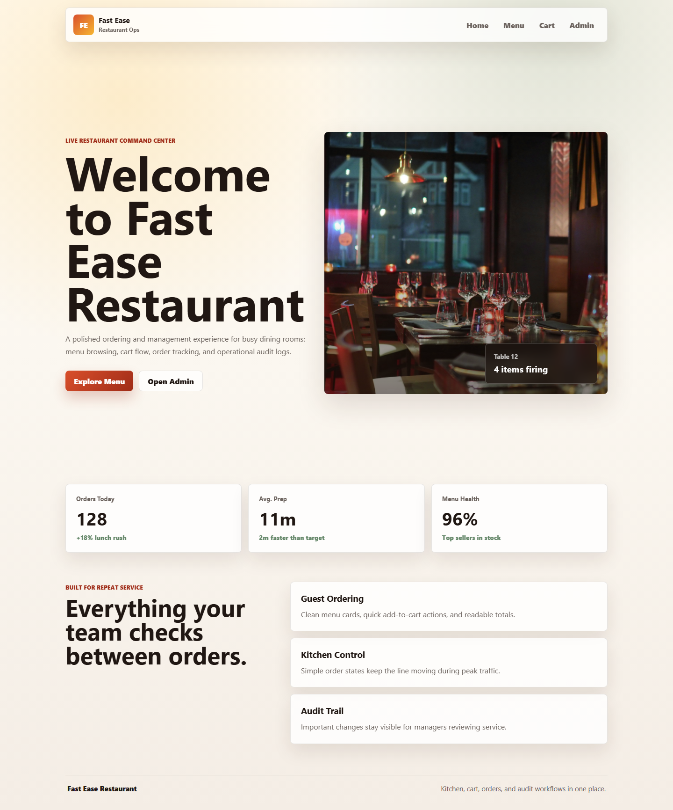
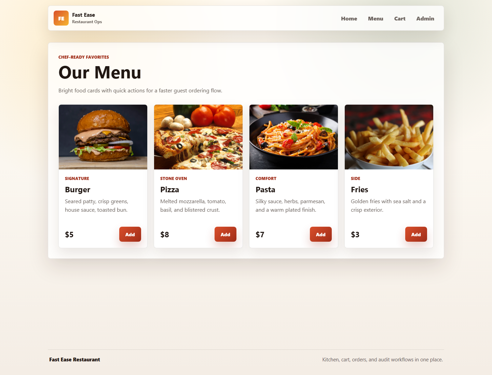
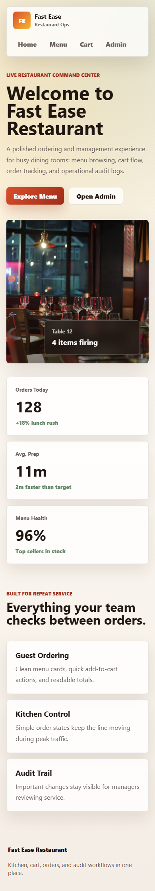

# Fast Ease Restaurant Management

Fast Ease is an animated React restaurant management app for browsing menu items, managing a cart, and reviewing admin workflows for menus, orders, and audit logs.

## Screenshots

### Home Desktop



### Menu Desktop



### Home Mobile



## Features

- Animated customer-facing home, menu, and cart pages.
- Sticky glass-style navigation and responsive layouts.
- Admin dashboard entry points for menu, order, and audit management.
- Shared cart state with item add and remove actions.
- Responsive Create React App build pipeline.

## Tech Stack

- React
- React Router
- Create React App / react-scripts
- CSS modules by feature area

## Getting Started

Install dependencies:

```bash
npm install
```

Run the development server:

```bash
npm start
```

Run the test suite:

```bash
npm test -- --watchAll=false
```

Create a production build:

```bash
npm run build
```

Capture fresh screenshots with Playwright:

```bash
npx playwright screenshot --viewport-size=1440,1100 --wait-for-timeout=1600 --full-page http://localhost:3000 docs/screenshots/home-desktop.png
npx playwright screenshot --viewport-size=1440,1100 --wait-for-timeout=1600 --full-page http://localhost:3000/menu docs/screenshots/menu-desktop.png
npx playwright screenshot --viewport-size=390,980 --wait-for-timeout=1600 --full-page http://localhost:3000 docs/screenshots/home-mobile.png
```

## Project Structure

- `public/` contains app metadata and static images.
- `src/components/` contains shared UI components.
- `src/pages/` contains route-level pages.
- `src/styles/` contains feature-specific stylesheets.
